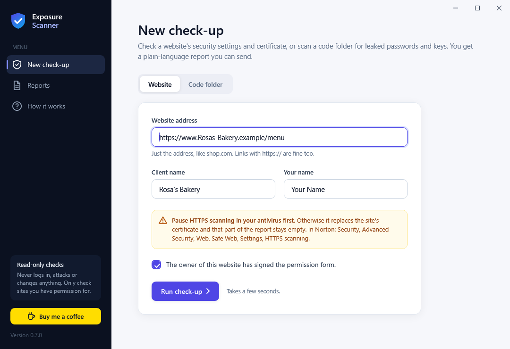
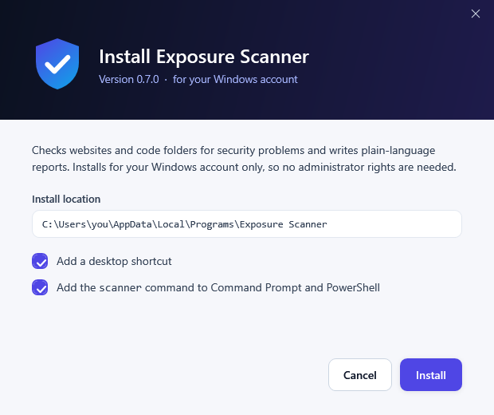
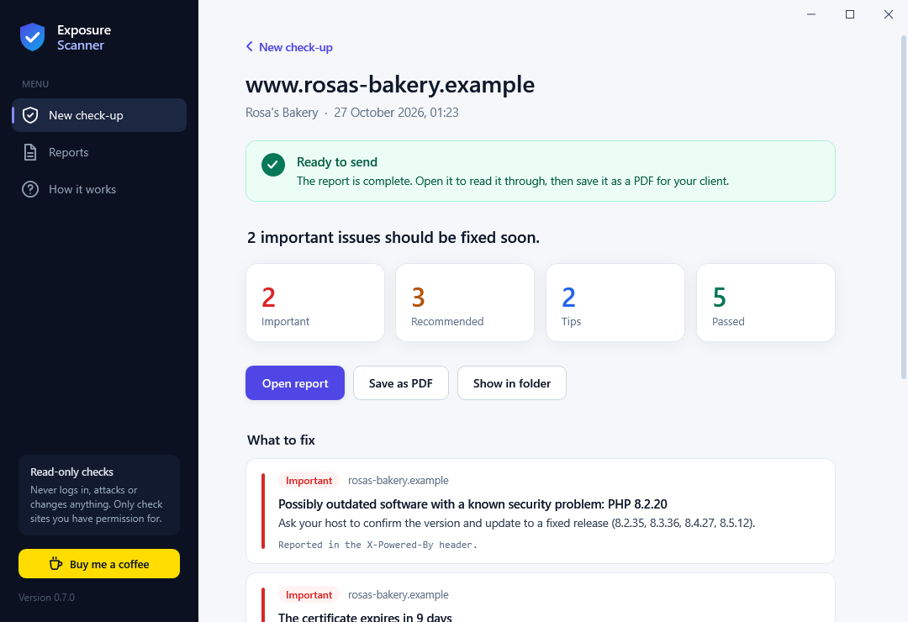

# Exposure Scanner

**A free Windows tool for IT and security professionals who run safety check-ups for clients.**

Exposure Scanner checks a website's security settings and certificate, or a code folder for leaked passwords and keys, and turns the result into a report your client can read: what was found, why it matters and how to fix it. It recognises common hosting platforms (GitHub Pages, Cloudflare, Vercel, Wix, Shopify and more) and tailors its advice to what the site owner can actually change.

Free tools already cover each piece on its own (for example Mozilla's HTTP Observatory and securityheaders.com for headers, SSL Labs for certificates, gitleaks for leaked keys). Exposure Scanner puts them in one offline desktop app and command line, with client-ready reports, JSON output and exit codes for scripting.

It is read-only and defensive: it never logs in, attacks, guesses passwords or changes anything.

[](https://github.com/onlyilir/exposure-scanner/releases/latest)
[](https://buymeacoffee.com/only.ilir)
[](LICENSE)



> **Only check what you own, or have written permission to check.** Website checks contact the site's server. Use them on your own sites, or on a client's site after they sign a permission form ([template](docs/permission-form.md)). The command line refuses network checks until you pass `--i-own-this`.

## Download and install

1. Download **Exposure-Scanner-Setup.exe** from the [latest release](https://github.com/onlyilir/exposure-scanner/releases/latest).
2. Run it. Windows may show "Windows protected your PC" because the installer is not signed with a paid certificate: click **More info**, then **Run anyway**.
3. Click **Install**. It installs for your Windows account only, with no administrator rights. You get a Start menu entry, an optional desktop shortcut and the `scanner` command in Command Prompt and PowerShell.



Uninstall from Windows Settings > Apps > Exposure Scanner. Your saved reports stay in `Documents\Exposure Scanner\Reports`.

**No installer wanted?** Download **Exposure-Scanner-&lt;version&gt;-portable.zip** instead, unzip it anywhere and run `ExposureScanner.exe`.

**Antivirus removed it?** Some antivirus programs (Norton, for example) quarantine new programs that few people have downloaded yet, especially unsigned ones, even when they are harmless. The source code is all here to check. You can restore the file from your antivirus quarantine and add an exception, and each release lists the SHA-256 of its files so you can confirm you have the original.

Requirements: Windows 10 or 11, 64-bit. Microsoft Edge (built into Windows) is used to save reports as PDF.

## How a check-up works

1. **Get permission.** Have the website owner sign the [permission form](docs/permission-form.md).
2. **Pause HTTPS scanning in your antivirus** if it has one (for example Norton Safe Web). Otherwise it replaces the site's certificate and that part of the report stays empty; the report warns you when this happens.
3. **Run the check-up.** Enter the website, the client's name and yours, tick the permission box, and press Run.
4. **Check the result.** A green "Ready to send" means the report is complete. A red "Not ready to send" says what to fix first.
5. **Save as PDF** and send it.



Reports are self-contained web pages with the verdict, counts (Important, Recommended, Tips, Passed), each problem with "Why it matters" and "What to do", and every check per website. See a [sample report](examples/sample-report.html) made from invented data.

## What it checks

| Command | What it looks at | How |
|---|---|---|
| `site <domain>...` | A whole website, for a client check-up | `http://` and `https://` requests plus the certificate. Checks the HTTPS redirect, security headers (HSTS, content security policy, framing, `nosniff`, referrer policy, cookie flags), software versions the server reveals, and the certificate. Follows one redirect to the same site (`www.` or not); never to another host. |
| `secrets <dir>` | Leaked keys and passwords in a project folder | Pattern rules: AWS, GitHub, Stripe live, Google API and Slack keys, private keys, URLs with a password, and `password=` / `token=` style assignments. Skips `node_modules`, virtual environments, binaries and files over 1 MiB. Says whether each file is tracked by git. |
| `py <dir>` | The LiteLLM 1.107.0 supply-chain incident | Installed packages in `site-packages`, pins in `requirements*.txt`, `poetry.lock`, `uv.lock`, and the IOC files `cook.pth` / `cook.py`. Also lists suspicious `.pth` lines. |
| `http <target>...` | Server versions named in banners: PHP (PHP2Shell), GitLab, Node.js, nginx, plus the same security-header checks as `site` | One `HEAD /` request per target. Reads the response headers only. |
| `tls <host[:port]>` | The certificate chain a server presents (eMudhra CA compromise) | One TLS handshake. Records the chain, SPKI SHA-256 hashes, expiry, key size, protocol, stapled OCSP and the OCSP/CRL URLs. |
| `all [<dir>]` | `secrets` + `py` on the folder, plus optional `--site` / `--http` / `--tls` targets | Runs the modules above and prints one combined report. |

The advisory data lives in `data/advisories.txt`; each line has a source URL. The file header explains the format.

## Build from source

The installer is the easy way. To build it yourself on Windows, use MSYS2 (https://www.msys2.org). In the **UCRT64** shell install:

```bash
pacman -S mingw-w64-ucrt-x86_64-gcc mingw-w64-ucrt-x86_64-openssl make
```

Then, from the project folder:

```bash
bash scripts/build_net.sh
```

This builds `scanner.exe` and the test programs and runs every test. `make` and `make test` do the same in an MSYS2 or Linux shell. For the memory-error check (AddressSanitizer + UBSan), install `mingw-w64-clang-x86_64-clang` and `mingw-w64-clang-x86_64-openssl`, then run `bash scripts/san_check.sh` in the **CLANG64** shell.

This `scanner.exe` needs the DLLs in `C:\msys64\ucrt64\bin` on its `PATH` when you run it outside MSYS2.

The desktop app and the installer (no further downloads: both are built with the .NET Framework compiler that ships with Windows; the installer is the app itself with the program files compressed inside it):

```bash
powershell -NoProfile -ExecutionPolicy Bypass -File app\Build-App.ps1
```

This writes a single-file `scanner.exe` (OpenSSL built in, file details from `src/scanner.rc`, `scripts/build_static.sh`), `ExposureScanner.exe`, `release\Exposure-Scanner-Setup.exe` and a portable zip. `app\Test-Setup.ps1` tests the installer in a temporary folder without changing the PC, and `ExposureScanner.exe --ui-snapshots <folder>` renders every screen to PNG.

## Command line

The installed `scanner` command finds its `data` folder next to itself. From a source checkout, run it in the project folder or pass `--advisories <file>`.

```bash
scanner site shop.example --i-own-this --html report.html --client "Shop Name" --by "Your Name"
scanner secrets C:/code/myproject
scanner py C:/code/myproject
scanner http https://myserver.example --i-own-this
scanner tls myserver.example --i-own-this
scanner all C:/code/myproject --site shop.example --i-own-this
```

Options:

- `--html <file>`: also write a plain-language client report (every command). `--client` sets the title and `--by` adds "Prepared by ...".
- `--json`: print one JSON object instead of text (every command).
- `--advisories <file>`: use another advisory file.
- `--timeout <ms>`: per connection (default 5000).
- `--rate <ms>` and `--threads <n>`: spacing between HTTP requests (default 200 ms) and parallel workers (default 8, max 16). At most 64 HTTP targets per run.
- `--spki-blocklist <file>`: SPKI hashes to flag (default `data/spki_blocklist.txt`).
- `--ca-file <file>`: extra trusted CA certificates for the trust check.

Exit codes: `0` clean, `1` findings, `2` error or no result. In a combined run, findings win: if one module has findings and another failed, the exit code is `1`, and the report shows the failure. Website settings (missing headers and so on) are advice, not findings: they never change the exit code.

### Client reports (`--html`)

The report is one self-contained web page (no external files) written for a business owner: a verdict, counts (Important, Recommended, Tips, Passed), then each problem with "Why it matters" and "What to do", then every check per website. `www.` and the bare domain are shown as one site. The desktop app saves it as a PDF with one click; from the command line, open it in a browser and use **Print > Save as PDF**. See [examples/sample-report.html](examples/sample-report.html) for a sample built from made-up data.

If anything went wrong, the report starts with a red **"Not ready to send"** box, and the command says so too. That happens when HTTPS inspection (such as Norton's web shield) replaced the certificate, when an address could not be reached, or when a code scan did not finish. Fix the cause and run the check again before sending.

Workflow for a client check-up: get the permission form signed, pause your antivirus HTTPS scanning, run `scanner site <their domain> --i-own-this --html <file> --client "<their name>" --by "<your name>"`, check there is no red box, save as PDF, send.

### JSON output

The top level has `tool`, `version`, `command`, `root` (for folder scans), one object per module that ran (`secrets`, `python`, `http`, `tls`), then `findings` (a total), `settings_issues` (website settings by level, when `http` ran), `summary` (the client report's verdict: counts, `ready_to_send`, `warnings` and the `issues` with their advice) and `exit_code`. Each module object has a `status` of `clean`, `findings` or `error`. Each `http` target also has `platform` (the recognised hosting platform), `location`, `redirected_from` and a `settings` list (`id`, `level`: `ok`/`note`/`tip`/`recommended`/`important`, `title`, `detail`). Strings are UTF-8. A byte that is not valid UTF-8 (for example a file name in the Windows ANSI code page) is written as `\ufffd`.

Secret values are never written, in text or JSON. Only a masked form appears, such as `****MPLE`.

## Limits

- **Banner versions are weak evidence.** Servers can hide or fake `Server` headers, and Linux distributions back-port fixes without changing the version number. Every `http` match is "possible, unconfirmed". GitLab does not show its version in banners; check it in the admin area.
- **No live revocation check.** `tls` lists each certificate's OCSP and CRL URLs but does not contact them. The stapled OCSP status is shown, but its signature is not verified.
- **The eMudhra SPKI blocklist is empty on purpose.** None of the sources checked published the compromised keys' hashes. Add them to `data/spki_blocklist.txt` only from a primary source (the Chromium CRLSet or the CCADB list). Until then, `tls` flags eMudhra/emSign certificates by issuer name only.
- **HTTPS inspection hides the real chain.** Antivirus programs such as Norton Web/Mail Shield re-sign HTTPS connections, even to `localhost`. The tool detects this and prints a warning, but the chain it sees is the antivirus chain, not the server's. Pause HTTPS scanning or run `tls` from another machine for a meaningful result.
- **Only the home page is checked.** The website checks read the headers of `/` (after one same-site redirect). Other pages can be set up differently. A server that refuses `HEAD` requests, or a bot shield that blocks the check, shows as "Page settings could not be checked".
- **A clean result is not proof.** The scanner only knows the rules in `data/advisories.txt`, its secret patterns and the header checks above.

## Tests

`scripts/build_net.sh` runs five test sets: version and advisory parsing, the folder scanners, the network modules (against servers the test starts on `127.0.0.1` only), the report, website-settings and HTML output, and command-line checks. The command-line checks use `127.0.0.1` port 1, where nothing listens, plus a local redirect server that `nettests --serve-redirect` starts on `127.0.0.1`. No request leaves the machine.

## Privacy

- Website checks send one ordinary request per address (the same as opening the home page) and one secure-connection handshake, identifying themselves as `exposure-scanner`.
- Code scans run on your computer only. Found passwords and keys are never written to a report; only a masked hint such as `****ABCD` is shown.
- The desktop app asks GitHub once at start-up whether a newer version exists. Nothing about you or your checks is sent.

## License

Free and open source under the [MIT license](LICENSE). `scanner.exe` includes OpenSSL and parts of the mingw-w64 runtime; their licenses are in [THIRD-PARTY-NOTICES.txt](THIRD-PARTY-NOTICES.txt).

## Support

Exposure Scanner is free. If it saves you time, you can [buy me a coffee](https://buymeacoffee.com/only.ilir). It helps keep the list of known problems up to date.
